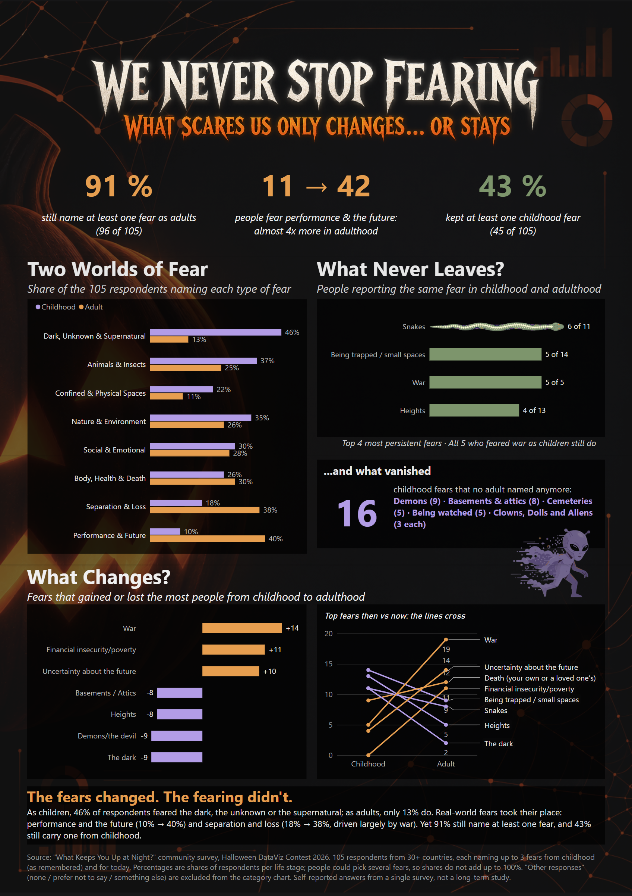

# 🎃 We Never Stop Fearing

**What scares us only changes... or stays.**

A one-page A4 Power BI poster built for the **"What Keeps You Up at Night?" Halloween DataViz Contest 2026** run by the Microsoft Fabric Community.

## The story

The contest dataset is an anonymous community survey: 105 people from 30+ countries named the fears they had as children and the fears they have today.

- **91%** of respondents (96 of 105) still name at least one fear as adults. We never stop fearing.
- **Two worlds of fear.** As children, 46% feared the dark, the unknown or the supernatural; as adults, only 13% do. Performance and the future rises from 10% to 40%, and separation and loss from 18% to 38% (driven largely by war).
- **What never leaves.** 43% (45 of 105) still carry at least one childhood fear. Snakes are the most persistent: 6 of the 11 people who feared them as children still do, and all 5 who feared war as children still do.
- **...and what vanished.** 16 childhood fears were named by no adult at all, led by demons, basements and cemeteries.
- **What changes.** The top childhood fears all decline and the top adult fears all rise: the lines cross. War gains the most people (+14); the dark and demons lose the most (−9 each).

## What's in this repo

| Path | Content |
|---|---|
| `images/poster.png` | The poster in high resolution (1696 × 2400 px) |
| `report/WeNeverStopFearing.pbix` | The Power BI report (open with Power BI Desktop) |
| `dax/measures.dax` | Every DAX measure used in the poster, with comments |

## How it was built

- **Data model:** the star schema from the contest starter file (`FactFearSelection` with `DimFear`, `DimCountry`, `DimGender` and `DimAgeGroup`). No source values were changed and no external data was added.
- **People, not selections:** every percentage on the poster is a share of *respondents* in each life stage (each person counted once), not a share of fear selections. People could pick up to 3 fears per life stage, so shares do not add up to 100%.
- **"Other responses"** (none of these, prefer not to answer, something else) are not a type of fear, so they are excluded from the category chart and from the 91% indicator.
- **Visuals:** grouped bars, a bar chart with an illustrated snake in place of one bar, diverging bars and a slope chart, all native Power BI visuals.
- **Accessibility (WCAG 2.2 AA):** text and chart colours meet contrast ratios on the dark background, every data visual has alt text describing its insight, values are labelled so colour is never the only cue, and the tab order follows the story with decorative images excluded.

## Limitations

These are self-reported answers from one survey of people who chose to take part. Childhood fears are remembered, not measured at the time, so the poster compares two snapshots rather than following people over time.

## Credits

- Dataset and contest: [Microsoft Fabric Community, Halloween DataViz Contest 2026](https://community.fabric.microsoft.com/blog/community_blog/turn-your-fears-into-data-join-our-halloween-data-visualization-contest/5374146). Survey and dataset created by Karin Szilágyi.
- Poster and analysis: Juan Mallo de la Calle.
